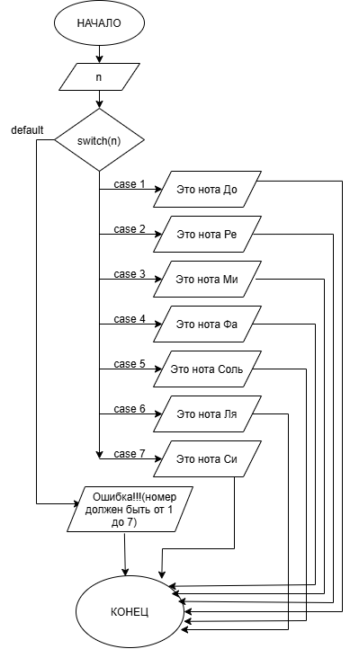

# Домашнее задание к работе 6
## Вариант: 30

## Условие задачи  
Составьте программу, определяющую название ноты по ее номеру: 1 –До, 2 – Ре и т.д. При вводе числа вне диапазона от 1 до 7 программа должна выдать сообщение об ошибке.

    
  

## 1. Алгоритм и блок-схема

### Алгоритм
1. **Начало**  
2. Объявить переменные:  
   - `double x` — координата точки по оси X  
   - `double y` — координата точки по оси Y  
3. Вывести приглашение к вводу: `puts("Введите x и y:")`  
4. Ввести значения координат: `scanf("%lf %lf", &x, &y)`  
5. Проверить попадание в нижний слой:  
   -`if (y >= 0 && y <= 2)`  
6.Проверить попадает ли в пределы x:    
   -`if ((x >= -5 && x <= -2) || (x > 1 && x <= 5))`    
   Если да:  
   -`printf("точка (%.0lf;%.0lf) входит в закрашенную область", x, y);`  
   Если нет:  
   -`printf("точка (%.0lf;%.0lf) не входит в закрашенную область", x, y);`  
7. `else if (y >= 2 && y <= 6)` - проверить попадание в верхний слой:  
8.Проверить попадает ли в пределы x:  
-`if (x >= -5 && x <= 5)`  
Если да:  
   -`printf("точка (%.0lf;%.0lf) входит в закрашенную область", x, y);`  
   Если нет:  
   -`printf("точка (%.0lf;%.0lf) не входит в закрашенную область", x, y);`  
   
9. `else`
   - Если ни одно из условий не выполнено — `printf("точка (%.0lf;%.0lf) не входит в закрашенную область", x, y);` точка не входит в область  
10. **Конец**  

### Блок-схема
  

---

## 2. Реализация программы

```c
#include <stdio.h>
#include <locale.h>
#include <math.h>

// Контрольные примеры:
// x=1 y=7   ---> не входит
// x=2 y=2   ---> входит
// x=222 y=2222 ---> не входит

int main()
{
    setlocale(LC_CTYPE, "UTF-8");
    double x;
    double y;

    puts("Введите x и y:");
    scanf("%lf %lf", &x, &y);

    if (y >= 0 && y <= 2)
    {
        if ((x >= -5 && x <= -2) || (x > 1 && x <= 5))
        {
            printf("точка (%.0lf;%.0lf) входит в закрашенную область", x, y);
        }
        else
        {
            printf("точка (%.0lf;%.0lf) не входит в закрашенную область", x, y);
        }
    }
    else if (y >= 2 && y <= 6)
    {
        if (x >= -5 && x <= 5)
        {
            printf("точка (%.0lf;%.0lf) входит в закрашенную область", x, y);
        }
        else
        {
            printf("точка (%.0lf;%.0lf) не входит в закрашенную область", x, y);
        }
    }
    else
    {
        printf("точка (%.0lf;%.0lf) не входит в закрашенную область", x, y);
    }
}
```
## 3. Результаты работы программы

>ПРИМЕР 1:  
>Введите x и y:  
>1 7  
>точка (1;7) не входит в закрашенную область
>  
>ПРИМЕР 2:  
>Введите x и y:
>2 2  
>точка (2;2) входит в закрашенную область
>  
>ПРИМЕР 3:  
>222 2222  
>точка (222;2222) не входит в закрашенную область

## 4. Информация о разработчике
### Чудакова Екатерина бИЦТ-261
